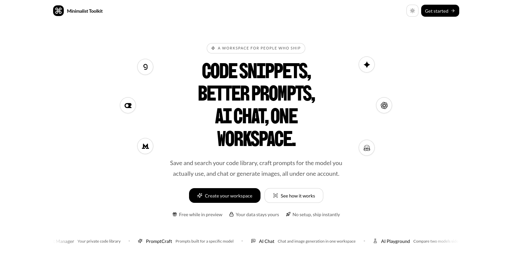

 <div align="center">

  

# Minimalist Toolkit

**A minimalist AI-powered workspace for developers, bringing chat, prompts, snippets, image mockups, model testing, and developer resources together in one place.**

[](https://nextjs.org)
[](https://react.dev)
[](https://typescriptlang.org)
[](https://tailwindcss.com)
[](https://supabase.com)
[](https://groq.com)
[](https://openrouter.ai)
[](https://vercel.com)

</div>

---

<div align="center">

  

</div>

---

## Overview

Minimalist Toolkit is a personal AI and developer workspace that brings everyday developer tools into one focused environment.

Instead of switching between multiple websites and applications, you can use AI chat, manage reusable snippets, craft prompts, generate image mockups, compare AI models, read AI news, and save useful resources from a single workspace.

The application follows a **single-account ownership model**:

- Every user's records belong to their authenticated account.
- PostgreSQL Row Level Security (RLS) protects user-owned data.
- Workspace features are accessible through authenticated routes.
- Personal API keys are used for individual requests and are never stored.
- The interface follows a minimal monochrome design system with white, black, and neutral colors.

Built with Next.js, Supabase, Groq, and OpenRouter.

---

## ✨ Features

- 📊 **Analytics Dashboard:** A central overview of workspace activity and tools.
- 🤖 **AI Chat:** Chat with AI using Groq and OpenRouter. The server can add your saved snippets as context.
- 📝 **Snippet Manager:** Store and manage reusable code snippets.
- ✨ **PromptCraft:** Build and enhance prompts, with a saved run history.
- 🧪 **Mockify:** Describe an idea and generate an image from it.
- ⚡ **AI Playground:** Compare two models and prompts side by side, including response time, token usage, and cost when the provider publishes it.
- 📰 **AI News:** Read AI updates from Hacker News, arXiv, GitHub, and Hugging Face.
- 🔐 **Vault:** Save skills, prompts, and plugin notes in a personal library.
- 👤 **Authentication:** Supabase email and password sign-in, Google sign-in, and password recovery.
- 🔑 **Personal API Keys:** Run Playground requests with your own provider keys. The app does not store them.
- 🎨 **Minimalist Interface:** Monochrome design with neutral colors and a light theme by default.
- 🌓 **Theme-Adaptive Branding:** The logo follows the selected theme.
- 🎬 **Motion:** Pages slide in from the right or left. Theme changes reveal from the top right when View Transitions are supported.
- 💀 **Content-Shaped Skeletons:** Loading placeholders shaped like the real content.
- 🛡️ **Protected Workspace:** Authenticated routes and database-level ownership policies.
- 🚦 **Rate Limiting:** Limits applied across IP, user, and personal-key request paths.

---

## 🛠 Tech Stack

| Category | Technology |
| --- | --- |
| Framework | Next.js 16 (App Router) |
| UI Library | React 19 |
| Language | TypeScript (Strict Mode) |
| Styling | Tailwind CSS 4 |
| Design Tokens | `app/globals.css` |
| Authentication | Supabase Auth |
| Database | Supabase PostgreSQL |
| Database Security | Row Level Security (RLS) |
| AI Providers | Groq + OpenRouter |
| Marketing Page Effects | Lenis |
| Scheduling | Vercel Cron |
| Package Manager | pnpm |
| Deployment | Vercel |
| Typography | Lato, Open Sans, BBH Bogle |

---

## 🚀 Quick Start

### Prerequisites

- Node.js 20.9 or newer
- pnpm
- Supabase project
- Groq API key
- OpenRouter API key (for OpenRouter functionality)
- Vercel account (for deployment and scheduled cron jobs)

### Installation

```bash
# 1. Clone the repository
git clone https://github.com/MuhammadTanveerAbbas/minimalist-toolkit.git
cd minimalist-toolkit

# 2. Install dependencies
pnpm install

# 3. Configure environment variables
cp .env.example .env.local

# 4. Add your environment variables
# See the Environment Variables section below

# 5. Start the development server
pnpm dev

# 6. Open the application
http://localhost:3000
```

### Database Setup

The database schema is maintained in:

```text
supabase/schema.sql
```

You can apply the schema using either of these methods.

**Option 1: Supabase SQL Editor**

1. Open your Supabase project.
2. Navigate to the SQL Editor.
3. Open `supabase/schema.sql`.
4. Execute the schema.

**Option 2: Supabase CLI**

```bash
supabase db query --file supabase/schema.sql
```

Table and policy creation is guarded so the file can be run more than once.

It creates the application tables, enables and forces Row Level Security, and includes a one-time cleanup of rows from retired news sources.

---

## 🔐 Environment Variables

Create a `.env.local` file in the project root.

```env
# Application
NEXT_PUBLIC_SITE_URL=http://localhost:3000

# Supabase
NEXT_PUBLIC_SUPABASE_URL=your_supabase_project_url
NEXT_PUBLIC_SUPABASE_ANON_KEY=your_supabase_anon_key

# Groq
GROQ_API_KEY=your_groq_api_key
GROQ_MODEL=your_groq_model

# OpenRouter
OPENROUTER_API_KEY=your_openrouter_api_key

# Server-only: AI News cron
SUPABASE_SERVICE_ROLE_KEY=your_supabase_service_role_key

# Optional: GitHub API
GITHUB_TOKEN=your_github_token

# Cron protection
CRON_SECRET=your_cron_secret

# Local testing only
DISABLE_AUTH_FOR_TEST=false
```

### Environment Variable Reference

| Variable | Required | Purpose |
| --- | --- | --- |
| `NEXT_PUBLIC_SITE_URL` | Yes | Public application URL |
| `NEXT_PUBLIC_SUPABASE_URL` | Yes | Supabase project URL |
| `NEXT_PUBLIC_SUPABASE_ANON_KEY` | Yes | Supabase public anonymous key |
| `GROQ_API_KEY` | For Groq | Groq API authentication |
| `GROQ_MODEL` | For Groq | Selected Groq model |
| `OPENROUTER_API_KEY` | For OpenRouter | OpenRouter API authentication |
| `SUPABASE_SERVICE_ROLE_KEY` | For news cron | Server-side privileged database access |
| `GITHUB_TOKEN` | Optional | GitHub API access |
| `CRON_SECRET` | For cron protection | Protects scheduled cron requests |
| `DISABLE_AUTH_FOR_TEST` | Local testing only | Disables authentication for test scenarios |

**Security notes:**

- Never commit `.env.local` to Git.
- Never expose `SUPABASE_SERVICE_ROLE_KEY` to client-side code.
- `DISABLE_AUTH_FOR_TEST` is strictly for local testing and must never be enabled in production.
- Personal Playground API keys are not stored by the application.

### Get Your API Keys

- Supabase: https://supabase.com/dashboard
- Groq: https://console.groq.com/keys
- OpenRouter: https://openrouter.ai/settings/keys
- GitHub: https://github.com/settings/tokens

---

## 📁 Project Structure

The tree below shows the main routes and folders in this repository.

```text
minimalist-toolkit/
├── app/
│   ├── page.tsx
│   ├── login/
│   ├── signup/
│   ├── forgot-password/
│   ├── update-password/
│   ├── features/
│   ├── auth/
│   │   └── callback/
│   │
│   ├── app/
│   │   ├── page.tsx
│   │   ├── dashboard/
│   │   ├── chat/
│   │   ├── snippets/
│   │   ├── promptcraft/
│   │   ├── mockify/
│   │   ├── playground/
│   │   ├── news/
│   │   ├── categories/
│   │   ├── profile/
│   │   └── settings/
│   │
│   ├── globals.css
│   │
│   └── api/
│       ├── chat/
│       ├── mockify/
│       │   └── generate/
│       ├── promptcraft/
│       │   ├── enhance/
│       │   ├── generate/
│       │   └── scrape/
│       ├── providers/
│       │   └── models/
│       ├── playground/
│       │   ├── run/
│       │   └── runs/
│       ├── cron/
│       │   └── news/
│       └── keep-alive/
│
├── components/
├── hooks/
├── lib/
│
├── supabase/
│   └── schema.sql
│
├── proxy.ts
├── .env.example
└── package.json
```

### Application Routes

| Route | Description | Access |
| --- | --- | --- |
| `/` | Public landing page | Public |
| `/login` | Sign-in | Public |
| `/signup` | Account registration | Public |
| `/forgot-password` | Password recovery | Public |
| `/update-password` | Password update | Public |
| `/auth/callback` | Authentication callback | Public |
| `/features` | Redirects to the landing page features section | Public |
| `/app` | Redirects to dashboard | Protected |
| `/app/dashboard` | Analytics dashboard | Protected |
| `/app/chat` | AI Chat | Protected |
| `/app/snippets` | Snippet Manager | Protected |
| `/app/promptcraft` | PromptCraft | Protected |
| `/app/mockify` | Mockify | Protected |
| `/app/playground` | AI Playground | Protected |
| `/app/news` | AI News | Protected |
| `/app/categories` | Vault | Protected |
| `/app/profile` | Account profile | Protected |
| `/app/settings` | Account preferences | Protected |

### API Routes

| Endpoint | Purpose |
| --- | --- |
| `/api/chat` | AI Chat requests |
| `/api/mockify/generate` | Image generation |
| `/api/promptcraft/enhance`, `/generate`, `/scrape` | Prompt enhancement, generation, and URL scraping |
| `/api/providers/models` | Provider model discovery |
| `/api/playground/run` | Execute Playground comparisons |
| `/api/playground/runs` | Playground run history |
| `/api/cron/news` | AI News scheduled ingestion |
| `/api/keep-alive` | Keep-alive endpoint |

---

### Snippet Context

Before generating a response, the server:

1. Identifies the authenticated user.
2. Loads that user's saved snippets.
3. Adds the snippets to the AI system prompt.
4. Applies a 24,000-character context budget.
5. Sends the prepared request to the selected AI provider.

The server prompt states how many snippets are saved and how many were included.

**Chat history is browser-only** and is not synchronized to PostgreSQL.

---

## ⚡ AI Playground

The Playground is designed for comparing AI models and prompts without leaving the workspace.

### Dual-Model Comparison

- Select a provider for each side.
- Choose a model independently for each side.
- Use separate prompts for comparison.
- Execute both sides and compare their responses.

### Provider Support

| Provider | Usage |
| --- | --- |
| Groq | Workspace provider or personal API key |
| OpenRouter | Workspace provider or personal API key |

### Comparison Results

The Playground displays:

- Model responses
- Response latency
- Token usage
- Cost information when provider pricing is published

Cost information is provider-dependent. For example, Groq cost is shown as **Not published** when per-token pricing is unavailable.

### Model Selection

OpenRouter provides open-weight model families by default, with an option to display all text models.

### Personal API Keys

Users can supply their own provider keys for individual Playground requests.

- Personal keys are used for the request.
- Keys are never stored by the application.
- Personal-key requests use their own per-minute fingerprint-based rate limits.
- Personal keys bypass the shared daily workspace run budget.

### Run Storage

Playground runs from signed-in users are stored in:

```text
playground_runs
```

---

## 📰 AI News Architecture

AI News collects updates from multiple public AI and developer sources through a scheduled ingestion process.

### Data Sources

| Source | Data |
| --- | --- |
| Hacker News Algolia | Hacker News stories |
| arXiv Export API | Research papers from `cs.AI` and `cs.LG` |
| GitHub Search API | Recently created repositories |
| Hugging Face Models API | Model updates and listings |
| Hugging Face Daily Papers API | Daily research papers |

### Cron Configuration

The news ingestion runs daily at 07:00 UTC. A second cron job calls `/api/keep-alive` every five days to keep the deployment warm.

```cron
0 7 * * *
```

### News Management

- News is collected from the documented external sources.
- GitHub repository discovery focuses on repositories created within the last seven days.
- GitHub API access can use an optional `GITHUB_TOKEN`.
- Items older than 30 days are pruned.
- News cards display official source information and live counts.
- Each card has one action that opens the original source.

### Manual Execution

The news endpoint can also be triggered manually:

```bash
curl -X GET "https://YOUR_DOMAIN/api/cron/news" \
  -H "Authorization: Bearer YOUR_CRON_SECRET"
```

Replace the domain and secret with your deployment values.

---

## 🔐 Vault

The Vault is the personal library for reusable developer and AI resources.

Route:

```text
/app/categories
```

### Supported Content

- Skills
- Prompts
- Plugin notes

### Available Operations

- Create and save resources.
- Set a resource type.
- Add a title and description.
- Store content.
- Organize items with categories and tags.
- Filter saved resources.
- Copy resource content.
- Edit existing items.
- Delete items.

### Database Ownership

Vault items are stored in:

```text
vault_items
```

Every record is owned by its authenticated user and protected through PostgreSQL RLS.

---

## 🗄 Database & Security

The database schema is maintained in:

```text
supabase/schema.sql
```

### Database Tables

| Table | Purpose |
| --- | --- |
| `snippets` | User-owned snippets |
| `mockify_generations` | Mockify generation records |
| `promptcraft_history` | PromptCraft history |
| `tool_documents` | Tool-related documents |
| `playground_runs` | Playground run history |
| `news_items` | AI News records |
| `vault_items` | Personal Vault resources |

### Row Level Security

The application follows strict user-level data ownership.

- RLS is enabled and forced on the documented application tables.
- Users can access only their own records. News rows are shared and readable by signed-in users.
- Anonymous users have no table privileges.
- The Supabase service role bypass is reserved for the server-side AI News cron workflow.

### Authentication

Authentication is provided through Supabase Auth.

Supported flows:

- Email and password sign-up
- Email and password sign-in
- Google authentication
- Forgot password
- Update password
- Authentication callback

### Route Protection

`proxy.ts` handles authentication guards for protected workspace routes.

The `/app` route redirects to:

```text
/app/dashboard
```

---

## 🚦 Rate Limiting

Rate limiting is applied across the application's AI and request workflows.

| Request Type | Rate Limit Strategy |
| --- | --- |
| AI requests | Per IP and authenticated user |
| Workspace Playground | 50 shared runs per user per day |
| Personal-key Playground | Fingerprint-based per-minute limits |
| Authentication | Per-client limits in `proxy.ts` |

### Workspace Playground Budget

Workspace provider requests share a daily allowance:

```text
50 runs / authenticated user / day
```

### Personal API Keys

Personal-key requests use fingerprint-based per-minute limits and do not consume the shared workspace daily run budget.

---

## 📦 Available Scripts

| Command | Description |
| --- | --- |
| `pnpm dev` | Start the development server |
| `pnpm typecheck` | Run TypeScript type checking |
| `pnpm lint` | Run the project linter |
| `pnpm build` | Build the application for production |
| `pnpm check:calculations` | Run calculation checks |

### Vercel Environment Setup

Pull environment variables from Vercel when working with a deployed project:

```bash
# Pull development environment variables
vercel env pull .env.local

# List production environment variables
vercel env ls production
```

---

## 🎨 Design System

Minimalist Toolkit uses a strict monochrome design language.

### Visual Direction

- White and black as the primary colors.
- Neutral tones for supporting interface elements.
- Light theme enabled by default.
- Theme-adaptive branding.
- Consistent visual hierarchy.
- Minimal decorative elements.

### Typography

| Font | Usage |
| --- | --- |
| Lato | Interface typography |
| Open Sans | Supporting typography |
| BBH Bogle | Display typography |

### Motion

Page navigation uses CSS slide animations from the right or left.

Theme changes use a top-right reveal through the View Transitions API when the browser supports it. Reduced motion settings disable these animations.

### Loading States

Content-shaped skeletons are used to make loading states match the structure of the content being displayed.

---

## 🌐 Deployment

Minimalist Toolkit is designed for deployment on Vercel.

### Deploy Your Own

[](https://vercel.com/new)

1. Push your project to a Git repository.
2. Import the repository into Vercel.
3. Configure the environment variables.
4. Ensure the Supabase schema has been applied.
5. Deploy the application.
6. Configure the Vercel Cron schedule for AI News.

### Production Deployment

```bash
# Deploy to production
vercel --prod

# Check production environment variables
vercel env ls production

# Check configured cron jobs
vercel crons list
```

### Production Checklist

- [ ] Configure `NEXT_PUBLIC_SITE_URL`.
- [ ] Configure Supabase project URL and public key.
- [ ] Configure the required AI provider API keys.
- [ ] Configure the server-only Supabase service role key.
- [ ] Configure `CRON_SECRET`.
- [ ] Apply `supabase/schema.sql`.
- [ ] Verify authentication redirects and callbacks.
- [ ] Verify workspace RLS policies.
- [ ] Verify the AI News cron schedule.
- [ ] Ensure `DISABLE_AUTH_FOR_TEST` is not enabled.

---

## 📋 Changelog

The current version is 1.1.0, as declared in `package.json`.

| Version | Changes |
| --- | --- |
| 1.1.0 | Current feature set and architecture described in this document |

---

## 🗺 Roadmap

Ideas for future development:

- [ ] Embeddings-powered workspace search.
- [ ] Prompt variables and one-click prompt runs.
- [ ] Token usage and spending dashboard.
- [ ] AI budget alerts.
- [ ] Synchronize AI Chat history to PostgreSQL.
- [ ] Personal model benchmark notes.
- [ ] Markdown export.
- [ ] JSON export.

---

## ⚠️ Important Notes

- **Single-account workspace:** Records belong to the authenticated user. This is not a team collaboration workspace.
- **Personal API keys:** Playground personal keys are not stored by the application.
- **Chat history:** AI Chat history is browser-only and is not synchronized to PostgreSQL.
- **AI pricing:** Cost estimates are displayed only when the provider publishes per-token pricing.
- **Service role security:** The Supabase service role key must remain server-side.
- **Test authentication:** `DISABLE_AUTH_FOR_TEST` must never be enabled in production.
- **News retention:** AI News automatically prunes items older than 30 days.
- **Provider limits:** Requests remain subject to the configured provider's availability and applicable rate limits.

---

## 🤝 Contributing

Contributions are welcome.

1. Fork the repository.
2. Create a feature branch:

   ```bash
   git checkout -b feature/amazing-feature
   ```

3. Make your changes.
4. Run project checks:

   ```bash
   pnpm typecheck
   pnpm lint
   pnpm build
   ```

5. Commit your changes:

   ```bash
   git commit -m "Add amazing feature"
   ```

6. Push your branch:

   ```bash
   git push origin feature/amazing-feature
   ```

7. Open a Pull Request.

---

## 📄 License

MIT License. Copyright (c) 2026 Muhammad Tanveer Abbas. See the LICENSE file for the full terms.

---


## 👨‍💻 Built by Muhammad Tanveer Abbas

<div>

**Muhammad Tanveer Abbas**
Technical Product Partner for B2B SaaS & Internals Tools

[](https://x.com/m_tanveerabbas)
[](https://linkedin.com/in/muhammadtanveerabbas)
[](https://github.com/MuhammadTanveerAbbas)

If this project helped you, please consider giving it a ⭐

</div>
